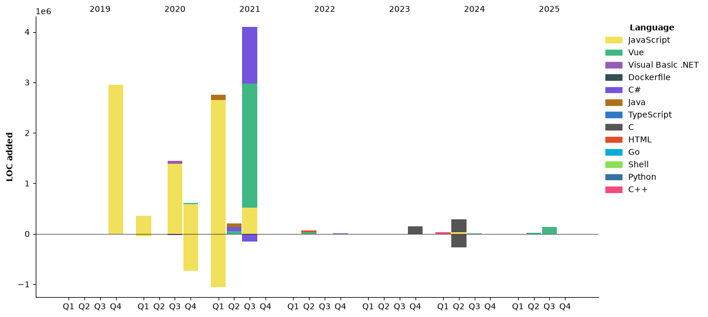

<h1 align="center">Hello 👋</h1>


<p align="center">
 <br>
 
</p>

<p align="center"></p>
<p align="center"></p>

<details align="left"><summary>📊 Some data about myself</summary>
<p>

<!--START_SECTION:waka-->


**🐱 My GitHub Data** 

> 📦 4.3 MB Used in GitHub's Storage 
 > 
> 🏆 0 Contributions in the Year 2026
 > 
> 🚫 Not Opted to Hire
 > 
> 📜 12 Public Repositories 
 > 
> 🔑 36 Private Repositories 
 > 
📅 **I'm Most Productive on Thursday** 

```text
Monday                   139 commits         ████░░░░░░░░░░░░░░░░░░░░░   16.09 % 
Tuesday                  131 commits         ████░░░░░░░░░░░░░░░░░░░░░   15.16 % 
Wednesday                115 commits         ███░░░░░░░░░░░░░░░░░░░░░░   13.31 % 
Thursday                 187 commits         █████░░░░░░░░░░░░░░░░░░░░   21.64 % 
Friday                   79 commits          ██░░░░░░░░░░░░░░░░░░░░░░░   09.14 % 
Saturday                 109 commits         ███░░░░░░░░░░░░░░░░░░░░░░   12.62 % 
Sunday                   104 commits         ███░░░░░░░░░░░░░░░░░░░░░░   12.04 % 
```


📊 **This Week I Spent My Time On** 

```text
🕑︎ Time Zone: Europe/Bucharest

🔥 Editors: 
Claude Code              28 hrs 53 mins      ████████████████████████░   94.60 % 
VS Code                  1 hr 38 mins        █░░░░░░░░░░░░░░░░░░░░░░░░   05.40 % 

💻 Operating System: 
Mac                      30 hrs 32 mins      █████████████████████████   100.00 % 
```

🤖 **AI Coding This Week** 

```text
⏱ AI Coding Time: 29 hrs 34 mins (96.79%)

✍️ 63,668 lines written by AI, 182 lines written by hand (99.71% AI-written)

🔤 42,129,391 Input Tokens, 11,218,659 Output Tokens

💵 $628.19 Estimated AI Cost This Week

🧠 21 AI Sessions, 510 AI Prompts

Sonnet                   63,677 lines        █████████████████████████   100.00 % 

🔎 AI Coding Insights:
🤖 AI-Driven — 99.71% of written lines came from AI
📄 Detailed Prompter — average 1,464 characters per prompt
🔁 Iterative Prompter — average 24 prompts per session
🚀 High AI Trust — 0.33% of changed lines were hand-edited
```

**Timeline**




 Last Updated on 01/11/2026 03:41:47 UTC
<!--END_SECTION:waka-->
</p>
